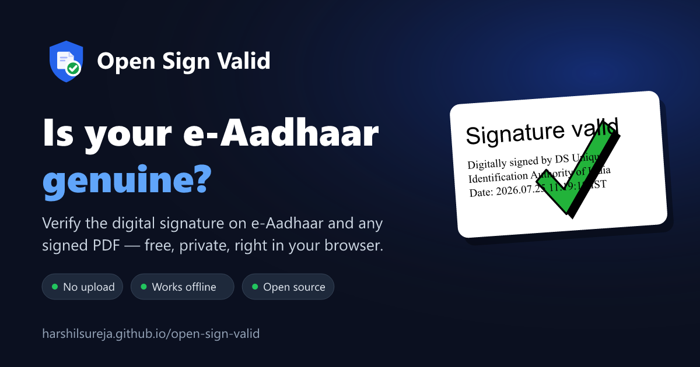

<p align="center">
  <a href="https://harshilsureja.github.io/open-sign-valid/">
    
  </a>
</p>

<h1 align="center">Open Sign Valid</h1>

<p align="center">
  <strong>Check if your e-Aadhaar or any digitally signed PDF is genuine — free, private, right in your browser.</strong>
</p>

<p align="center">
  <a href="https://github.com/harshilsureja/open-sign-valid/actions/workflows/deploy.yml"></a>
  <a href="https://github.com/harshilsureja/open-sign-valid/releases/latest"></a>
  <a href="https://harshilsureja.github.io/open-sign-valid/"></a>
  <a href="LICENSE"></a>
  
  <a href="https://github.com/harshilsureja/open-sign-valid/issues"></a>
</p>

<p align="center">
  <a href="https://harshilsureja.github.io/open-sign-valid/"><strong>👉 Open the app</strong></a>
  &nbsp;·&nbsp;
  <a href="#-how-to-use">How to use</a>
  &nbsp;·&nbsp;
  <a href="#-faq">FAQ</a>
  &nbsp;·&nbsp;
  <a href="https://github.com/harshilsureja/open-sign-valid/issues">Report a problem</a>
</p>

---

## 🤔 What is this?

Every e-Aadhaar downloaded from UIDAI carries a **digital signature**. If anyone
edits the PDF (name, photo, date of birth, address), that signature breaks.

Most phone and browser PDF viewers can't check signatures, so they just show
**"Signature Not Verified"** with a question mark. **Open Sign Valid** checks
it for real, like Adobe Reader does, and shows the result in plain words:

| Result | What it means | What to do |
|---|---|---|
| ✅ **Genuine** | Signed by a trusted authority (like UIDAI) and **not changed** since. | Nothing. The document is authentic. |
| ⚠️ **Be careful** | The file is unchanged, but the signer couldn't be confirmed, **or** something was added after signing. | Check where the file came from. |
| ❌ **Not genuine** | The file was **edited after it was signed**. | Don't trust it. Get a fresh copy from the official source. |

It also works for other signed PDFs: DigiLocker documents, eSign agreements,
GST and income-tax certificates, invoices and contracts.

## 📱 How to use

1. **Open** <https://harshilsureja.github.io/open-sign-valid/> on your phone or computer.
2. **Choose your PDF**, for example the e-Aadhaar you downloaded from
   [myaadhaar.uidai.gov.in](https://myaadhaar.uidai.gov.in/).
3. **Read the result** at the top: green tick, yellow warning or red cross.

**Password-protected e-Aadhaar?** The signature is checked without the
password. To view and print the pages, type the password: the **first 4
letters of the name in CAPITALS + year of birth** (for example `SURE1990`).

You can **print** the document (big **Print** button on phones, or `Ctrl + P`).
It prints at true paper size with the verification result on the signature.

## 🔒 Your privacy

- **Nothing is uploaded.** Your file is opened and checked only on your own device.
- **No sign-up, no cookies, no tracking or analytics.**
- **Works offline** once the page has loaded.
- A strict security policy blocks the page from contacting any other website.
- **Open source**, so anyone can check the code.

## ✨ Features

- Adobe-style green tick / red cross, shown on the signature box itself. Only
  the validity icon and title change; the signed text is shown exactly as signed.
- Detects documents that were **edited**, or had **content added after signing**
- Official **CCA India** root certificates built in, so genuine e-Aadhaar is
  recognised automatically
- Works with **password-protected** PDFs
- Sharp PDF viewer with **fit-to-width** and **actual-size (100%)** zoom
- High-quality **printing** (300 DPI, one sheet per page, also on phones)
- Simple layout for first-time users, **mobile friendly**, light & dark mode

## ❓ FAQ

<details>
<summary><strong>Is my e-Aadhaar uploaded anywhere?</strong></summary>

No. Everything happens inside your browser, on your device. The site doesn't
have a server that could receive your file.
</details>

<details>
<summary><strong>Why do other apps say "Signature Not Verified"?</strong></summary>

That text and question mark are a picture stored inside the PDF. Viewers that
can't check signatures just show that picture. Open Sign Valid checks the
signature and shows the real result.
</details>

<details>
<summary><strong>Is this an official UIDAI or government website?</strong></summary>

No. It's an independent, free, open-source project. It uses the official
CCA India root certificates published at <https://cca.gov.in> to confirm signers.
</details>

<details>
<summary><strong>Does it check whether a certificate was revoked?</strong></summary>

Not yet. Revocation checks (OCSP/CRL) need a request to the issuing authority,
which browsers usually block. It's planned as an optional feature.
</details>

---

## 🛠️ For developers

### Run it locally

Requires Node.js 22 or newer.

```bash
git clone https://github.com/harshilsureja/open-sign-valid.git
cd open-sign-valid
npm install
npm run dev
```

Then open <http://localhost:3000>.

| Command | What it does |
|---|---|
| `npm run dev` | Start the dev server on port 3000 |
| `npm test` | Run the verification tests (signed PDFs are generated on the fly) |
| `npm run build` | Build the static site into `dist/client` |
| `npm run samples` | Write sample PDFs (valid, tampered, modified, e-Aadhaar-like) to `samples/` |
| `npm run images` | Regenerate the social preview image and app icons in `public/` |

### Project structure

```
src/
  lib/verify/      signature verification (ByteRange, CMS, certificate chain, timestamps)
  lib/trust/       trusted roots — bundled CCA India certificates + user-added ones
  lib/appearance.ts  Adobe-style handling of layered signature boxes (display only)
  lib/stamp.ts     draws the tick / ? / cross and title on the signature box
  lib/print.ts     300 DPI printing
  components/      UI (landing page, viewer, signature panel, dialogs)
  routes/          pages and <head> (SEO, Open Graph, structured data)
scripts/           build helpers, sample PDFs and image generator
test/              Vitest tests
```

### How verification works

1. Find every `/ByteRange` + `/Contents` pair in the raw PDF bytes. This works
   on password-protected files too, because signature values are never encrypted.
2. Hash the signed byte ranges and compare with the CMS `messageDigest`.
3. Verify the CMS (PKCS#7) signature with WebCrypto via [PKI.js](https://github.com/PeculiarVentures/PKI.js).
4. Build the certificate chain to a trusted root, checking validity at signing
   time (the timestamp time, when there is one).
5. Check whether bytes were added after the signature.

Supported formats: `adbe.pkcs7.detached`, `ETSI.CAdES.detached`, `adbe.pkcs7.sha1`.

### Trusted roots

A signature is green only when its chain ends at a trusted root. The official
CCA India roots from <https://cca.gov.in/root_certificate.html> are bundled in
[`src/lib/trust/roots/`](src/lib/trust/roots/) (fingerprints are listed in the
README there). Users can also trust extra certificates; those are stored in
their browser only.

### Deploy

Every push to `main` builds and deploys to GitHub Pages via
[`.github/workflows/deploy.yml`](.github/workflows/deploy.yml)
(repo **Settings → Pages → Source: GitHub Actions**).

- `BASE_PATH` (set by the workflow to `/<repo>/`) serves the site from the
  project-page subpath. Leave it unset locally or on a custom domain.
- `VITE_SITE_URL` sets the absolute URL used for the canonical link, social
  preview image, `robots.txt` and `sitemap.xml`.
- The landing page is prerendered to static HTML, so search engines and link
  previews can read it.

### Tech stack

TanStack Start · React · TypeScript · shadcn/ui · Tailwind CSS · pdf.js · PKI.js · Vitest

## 🤝 Contributing

Bug reports, ideas and pull requests are welcome. Please
[open an issue](https://github.com/harshilsureja/open-sign-valid/issues) first
for bigger changes. See [CHANGELOG.md](CHANGELOG.md) for release history.

## 📄 License

[Apache-2.0](LICENSE). Free to use, change and share.

> **Disclaimer:** Open Sign Valid is an independent open-source project and is
> not affiliated with UIDAI, CCA or the Government of India. Results are for
> information; revocation status is not checked yet.
